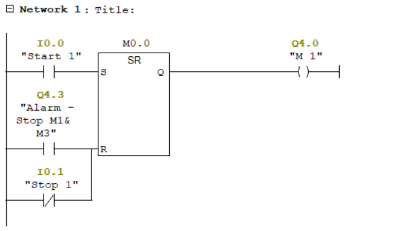
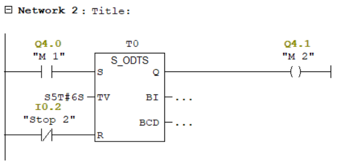
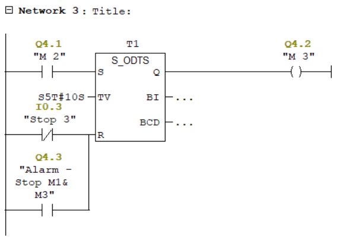
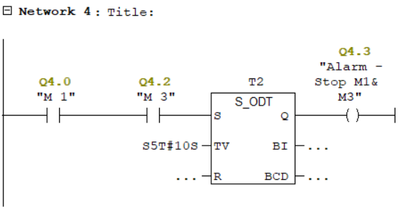
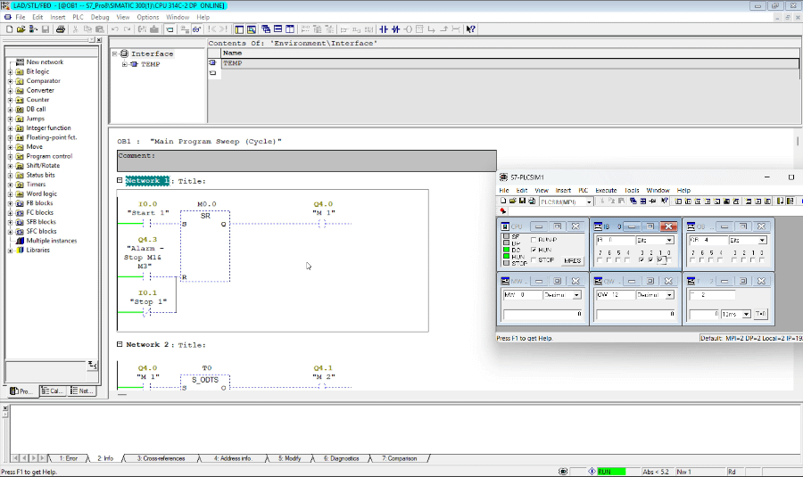

# PLC Sequential Motor Control

A Siemens S7-300 PLC project for sequential control of three motors using Ladder Logic (LAD).

## Project Overview

This project implements a sequential motor control system with independent stop functionality and timed protection against excessive simultaneous operation of motors M1 and M3.

The control logic is developed using **SIMATIC Manager (STEP 7 V5.7)** for a **Siemens S7-300 PLC** and tested in a simulation environment.

## Operating Sequence

1. When the Start command is activated, motor M1 starts.
2. After 6 seconds, motor M2 starts.
3. After another 10 seconds, motor M3 starts.
4. Each motor can be stopped independently without intentionally affecting the operation of the other motors.
5. If M1 and M3 remain ON simultaneously for 10 seconds, both motors are switched OFF and an alarm is activated.

## Hardware & Software

- PLC: Siemens S7-300
- CPU: CPU 314C-2 DP
- Programming Software: SIMATIC Manager / STEP 7 V5.7
- Programming Language: Ladder Logic (LAD)
- Testing: PLC Simulation

## I/O Assignment

| Address | Description |
|---|---|
| I0.0 | Start command |
| I0.1 | Stop M1 |
| I0.2 | Stop M2 |
| I0.3 | Stop M3 |
| Q4.0 | Motor M1 |
| Q4.1 | Motor M2 |
| Q4.2 | Motor M3 |
| Q4.3 | Alarm signal |

## Timer Configuration

| Timer | Preset Time | Function |
|---|---:|---|
| T0 | 6 seconds | Delayed start of M2 |
| T1 | 10 seconds | Delayed start of M3 |
| T2 | 10 seconds | Monitoring simultaneous operation of M1 and M3 |

## Project Files

- `PLC_Program.pdf` – Exported PLC program and LAD networks.
- `Screenshots/` – Program and simulation screenshots.
## Ladder Logic (LAD) Networks

The PLC program is organized into four networks:

### Network 1 – Motor M1 Control

### Network 2 – Motor M2 Delayed Start

### Network 3 – Motor M3 Delayed Start

### Network 4 – Simultaneous Operation Monitoring

## Learning Objectives

- Sequential motor control using PLC.
- Timer-based control with S5 timers.
- Independent motor start/stop logic.
- Monitoring simultaneous motor operation.
- Alarm and protection logic.
- Siemens S7-300 programming using LAD.

## Simulation Demo

The following animation demonstrates the PLC program execution, including sequential motor startup, independent motor stop functionality, and timed protection logic.

## Project Status

Implemented and tested in a simulation environment.

---

*This project is an educational simulation. Practical implementation with real motors requires appropriate electrical protections, safety circuits, and engineering validation.*
